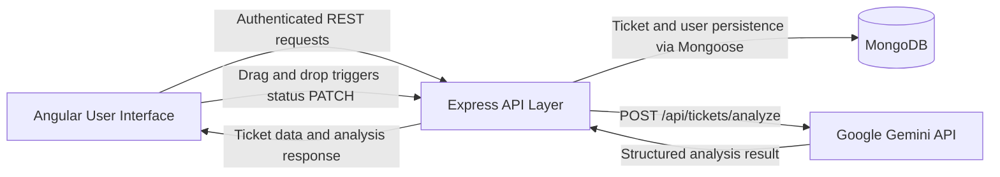

# System Architecture Diagram

## Diagram Notes
- The frontend does not call the AI provider directly.
- The Express backend authenticates and authorizes analysis requests, validates descriptions, and validates Gemini's structured response.
- The analysis response contains `aiSummary`, `priority`, `category`, and `resolutionSuggestions`; the result is returned to the UI and is not saved as a separate analysis record.
- MongoDB persists tickets and users. Ticket status changes are sent to the backend through the status endpoint.
