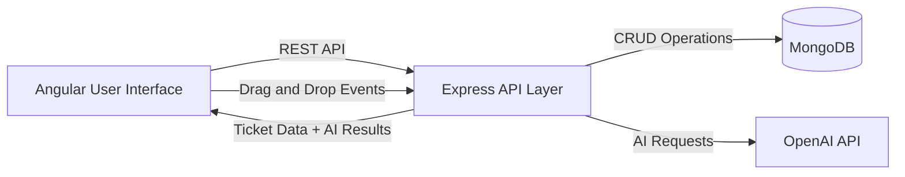

# System Architecture Diagram

## Diagram Notes
- The frontend remains independent from the AI provider
- The backend orchestrates API communication and domain logic boundaries
- MongoDB persists ticket and workflow state
- OpenAI provides summary and recommendation capabilities
